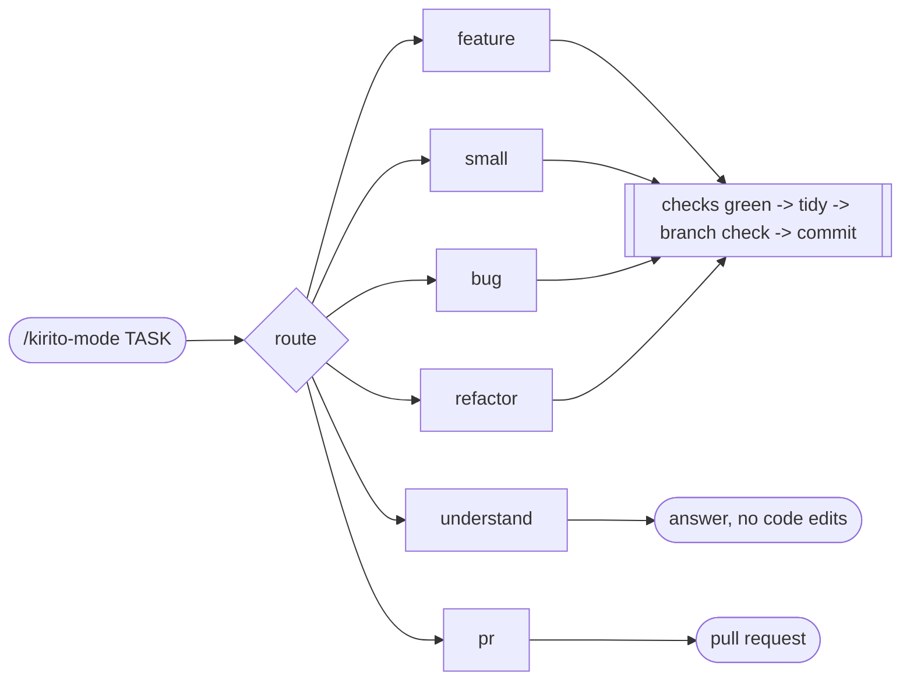
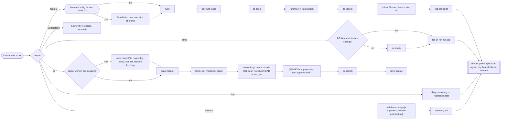
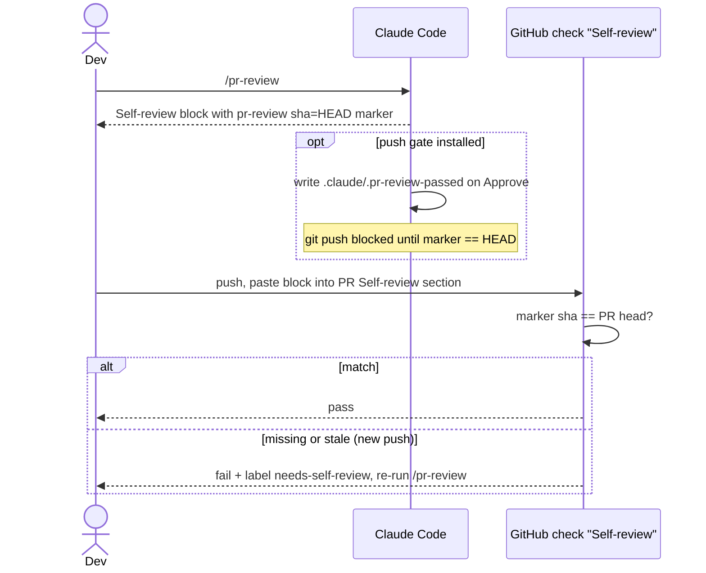

# hkirito

**One command for Claude Code that picks the right workflow for any task.**

You type `/kirito-mode <task>`. It decides whether the task is a feature, a small change, a bug, a question, a refactor, or a PR, then runs the matching chain of skills. You don't have to remember which skill comes next.

```text
you    > /kirito-mode the login button does nothing on Safari
claude > Route: bug - something is broken on one browser
         Goal: make the login button work on Safari; smallest change: fix the broken handler
```

The router prints its choice first. If it guessed wrong, say so in your next message and it switches route.

---

## The six routes

| Route | Use it for | What runs |
|---|---|---|
| **feature** | New behaviour that spans modules or needs decisions | interview -> spec -> tickets -> test-first per ticket -> commit |
| **small** | A copy fix, config change, one function | test (or run the app and look) -> commit |
| **bug** | Something broken, throwing, failing, or slow | reproduce -> regression test -> fix -> commit |
| **understand** | "How does X work?", "Why is it like this?" | `how` / `why` / `explain` / `research`, no code edits |
| **refactor** | Restructure without changing behaviour | design the module -> subtract -> tests stay green -> commit |
| **pr** | Open or update a pull request | checks green -> review loop (max 3 rounds) -> PR sketch -> `gh pr create` |



Every route that changes code ends the same way: tests, lint, and typecheck pass, the spec and plan match the code, `tidy` strips needless comments, and the commit lands on a feature branch, never on `main`.

## Why use it

- **The workflow is chosen for you.** You describe the task once and the router picks the skills.
- **The design ships with the code.** Specs go to `docs/specs/<feature>.md` and plans to `docs/plans/<feature>/NN-<slug>.md`, so the PR carries its own design record. There is no issue tracker to set up.
- **"Done" means checked.** Nothing is called done, fixed, or passing until the real test, lint, and typecheck commands have run.
- **Review happens once, at the PR.** A fresh reviewer agent reads the diff, at most 3 rounds, and it never starts while a check is red.
- **It keeps token cost down.** Opus 5.5 writes specs and plans and runs the reviewer, Sonnet 5.5 writes code. Models switch only after a `/clear`, so a model switch never re-bills the cache mid-conversation.
- **It works where hooks are blocked.** Every flow runs with Claude hooks disabled. Hooks are optional extras.

## Quick start

```bash
git clone git@github.com:minhhuy1201/hkirito.git ~/hkirito
cd ~/hkirito

mkdir -p ~/.claude/skills ~/.claude/agents
for d in skills/*/; do
  name=$(basename "$d")
  if [ -e ~/.claude/skills/$name ] && [ ! -L ~/.claude/skills/$name ]; then
    echo "skip $name: a real directory exists in ~/.claude/skills (move it aside first)"
    continue
  fi
  ln -sfn "$PWD/skills/$name" ~/.claude/skills/$name
done
ln -sfn "$PWD/agents/reviewer.md" ~/.claude/agents/reviewer.md
ln -sfn "$PWD/agents/implementer.md" ~/.claude/agents/implementer.md
```

Start a new Claude Code session and run:

```text
/kirito-mode <what you want done>
```

Before your first run:

- **Name clashes.** Skills are not namespaced (`/kirito-mode`, `/tidy`, `/tdd`). If `~/.claude/skills/` already has a real directory with the same name, the loop above skips it. Move yours aside first.
- **Turn off superpowers.** If you use the superpowers plugin, disable it in `enabledPlugins` in `~/.claude/settings.json`, because its session hook competes with the router. Its two best rules (verify before claiming done, verify each review finding) are built into `kirito-mode`.
- **`grill-with-docs`** needs `grilling` and `domain-modeling` enabled. Check `skillOverrides`.

## Make it yours

| To change | Edit |
|---|---|
| How tasks are classified | `skills/kirito-mode/SKILL.md` (the router) |
| What one route does | `skills/kirito-mode/routes/<route>.md` |
| What the reviewer checks | `agents/reviewer.md`, `skills/review-loop/`, `skills/pr-review/` |

`review-loop` and `agents/reviewer.md` assume the author's own rules (branch names, a Vietnamese review summary). [`CLAUDE-huykrito.md`](CLAUDE-huykrito.md) is a copy of those rules, for reference.

---

## Going deeper

<details>
<summary><b>The full route map</b></summary>



Steps in `[brackets]` run only when they're needed:

- `[how]` runs only when the area is unfamiliar.
- `[architect]` runs when tickets cross a module seam, and `interrogate` joins it only when the design is contested.
- `[blast-radius]` runs only when the diff touches a public interface, schema, data format, or widely imported export.
- `[+ improve-codebase-architecture]` is an optional search for refactor candidates.

Spec: [`docs/specs/kirito-mode.md`](docs/specs/kirito-mode.md). Plan: [`docs/plans/kirito-mode.md`](docs/plans/kirito-mode.md).

</details>

<details>
<summary><b>The <code>pr</code> route and <code>review-loop</code></b></summary>

- **Clean context.** If the session already did other work, the route writes a `## Handoff` into the branch's review log. The log lives under the git directory, so it survives `/clear` and never shows in `git status`. Then you `/clear`, switch to Sonnet 5.5, and run `/kirito-mode pr <log path>`.
- **Checks first.** Tests, lint, and typecheck must pass before every reviewer dispatch. A red check gets fixed without using a round. The reviewer gets the check output and a diff stat, and re-runs a check only when a finding needs more evidence.
- **3 rounds, gate included.** Every round follows the `pr-review` checklist and reports on two axes: Standards and Spec. A round that reviews the committed `HEAD` and finds no `must-fix` is the gate, and it writes the marker when a `pr-review` skill exists. There's no separate full re-review. If round 3 still doesn't pass, the loop stops and hands over to you. Commit before the round you expect to pass.
- **Findings by class.** Each kind of defect is one finding that lists every location, so one fix pass clears it.
- **`REVIEW.md`.** Before the gate round, the main session proposes each `must-fix` class as a `REVIEW.md` entry (repo root) or a lint rule, and you approve each one. Implementers and reviewers read `REVIEW.md` before they start.
- **Models.** Opus 5.5 runs specs, plans, and the `reviewer`, which is pinned and never overridden. Sonnet 5.5 runs the main session during implementation and the `pr` route. The prompt cache is per model, so a `/model` switch mid-conversation re-bills the whole context uncached. The session therefore switches only at a cleared boundary (`/clear`, `/model`, resume command), and it never switches for you.

</details>

<details>
<summary><b>Delegate mode: one fresh agent per ticket</b></summary>

`/kirito-mode --delegate <task>` hands each feature ticket to a fresh `implementer` subagent while the main session runs Sonnet 5.5.

1. The `feature` route stops once you approve the ticket breakdown. It then asks you to `/clear`, switch to Sonnet 5.5, and run `/kirito-mode --delegate feature <plan dir>`. Later spec or plan work starts a new Opus session.
2. `to-tickets` tags each ticket `Model: haiku` (mechanical work) or `Model: sonnet`. A Haiku ticket that fails its checks twice, or draws a `must-fix`, is re-dispatched once on Sonnet.
3. An implementer is done only when tests, lint, and typecheck pass.
4. During review, fixes that touch at most 2 files and change no interface are made inline. The exception is a `must-fix` on a `haiku` ticket that hasn't been escalated yet, which goes to Sonnet with the batch. Larger fixes go to one implementer for the whole batch.

</details>

<details>
<summary><b>Skills you type yourself</b></summary>

These load only when you type them (`disable-model-invocation`):

| Skill | What it does |
|---|---|
| `/wayfinder` | Plans work too big for one session as a map of decision tickets in repo files |
| `/statechart` | Draws a system's states as a chart, useful for bugs that depend on event order. Its first run downloads TLC and Java with mise (about 305 MB) |
| `/create-formal-verification-skill`, `/maintain-formal-verification-skill` | Set up formal verification for a project and keep it in line with the code |
| `/sharpen` | Makes a task deeper, not bigger, then rewrites the prompt |
| `/correct` | Finds the mistakes agents keep repeating in a repo and makes each one impossible |
| `/wait-what` | Re-explains the last answer in plain terms |
| `/to-questionnaire` | Turns an open decision into a questionnaire for someone else to fill in |
| `/wizard` | Generates a script that walks a human through manual steps |
| `/learn`, `/retro`, `/handoff`, `/unslop` | Learn a concept, review a session, hand off to another agent, remove AI-sounding phrasing from writing |

</details>

<details>
<summary><b>Token usage report</b></summary>

```bash
node skills/review-loop/scripts/usage.mjs [session...]
```

It needs only Node, with nothing to install. Each argument is a session `.jsonl` file or directory. With no argument, it reports the latest session of the current project. For each session it shows:

- main-session spend, in total and from the first reviewer dispatch
- every subagent with its type, model, and spend, plus sums per agent type and per model
- a cache hit rate on every line (`hit=`, read / (read + write + fresh))
- cache rewrites after idle gaps longer than the cache TTL
- every model switch in the main session, with the cache write of the switching call

Spend is in input-equivalent units based on the published cache multipliers, not dollars.

</details>

<details>
<summary><b>Commit gate (optional): make sure <code>tidy</code> ran</b></summary>

`tidy` strips needless comments and AI-sounding prose from the staged diff. Every route already runs it, and the gate makes it hard to skip.


Pick one:

| Gate | Where it works | Setup |
|---|---|---|
| Claude hook | Machines where Claude hooks are allowed | Merge `hooks/settings-snippet.json` into `hooks.PreToolUse` in `~/.claude/settings.json`, and replace `/ABSOLUTE/PATH/TO/hkirito`. Needs `python3` and `sha256sum`. |
| Git hook | Machines where Claude hooks are blocked | `cp ~/hkirito/githooks/pre-commit .git/hooks/pre-commit` (with Husky, call it from `.husky/pre-commit`). It checks only when `CLAUDECODE=1`, so commits made by people go through. |

</details>

<details>
<summary><b>PR template and required self-review (per project)</b></summary>

```bash
cd /path/to/your-project
mkdir -p .github/workflows
cp ~/hkirito/templates/github/pull_request_template.md .github/
cp ~/hkirito/templates/github/workflows/pr-self-review.yml .github/workflows/
```

Then make **Self-review** a required check in branch protection for the default branch.



- **Push gate (optional).** Merge `hooks/settings-snippet-push-gate.json` into `hooks.PreToolUse` (with the same path replacement) and add `.claude/.pr-review-passed` to `.gitignore`. It only sees pushes made from Claude Code, so it's not a security boundary.
- Bot PRs (Dependabot) skip the check.
- The default branch is assumed to be `main`. If yours differs, change `origin/main` in step 1 of `skills/pr-review/SKILL.md`. Adjust the template wording and the `<type>(<scope>)` rule to fit your team.

</details>

<details>
<summary><b>pixel-blast: a safety net for risky commands</b></summary>

[`mods/pixel-blast`](mods/pixel-blast/README.md) is a Claude Code mod that holds commands like `rm -rf`, `git reset --hard`, force pushes, and database migrations. Before you decide whether to run one, it shows what the command would touch:

```text
rm -rf build
3 files (492K)

build/app.js      ■■■■■■   392K
build/app.css     ■          88K
build/sub/x.txt   ■           4K

1: proceed   2: cancel
```

See its [README](mods/pixel-blast/README.md) for install steps and limits.

</details>

## What's in the repo

```text
skills/            kirito-mode, tidy, and the vendored and ported skills
agents/            reviewer.md, implementer.md
hooks/             optional commit and push gates, plus settings snippets
mods/              Claude Code mods (pixel-blast)
templates/         PR template and Self-review workflow to copy into a project
githooks/          optional pre-commit hook
docs/              this repo's own specs and plans
THIRD_PARTY.md     upstream sources and licenses
```

## Credits

Many skills are copied or adapted from [mattpocock/skills](https://github.com/mattpocock/skills) and [cursor/plugins pstack](https://github.com/cursor/plugins/tree/main/pstack), both MIT licensed. Each vendored skill carries a comment naming its upstream repo and commit. See [THIRD_PARTY.md](THIRD_PARTY.md).
