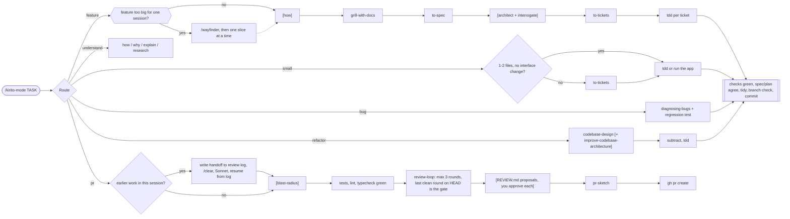
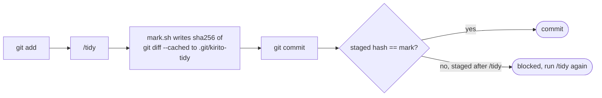
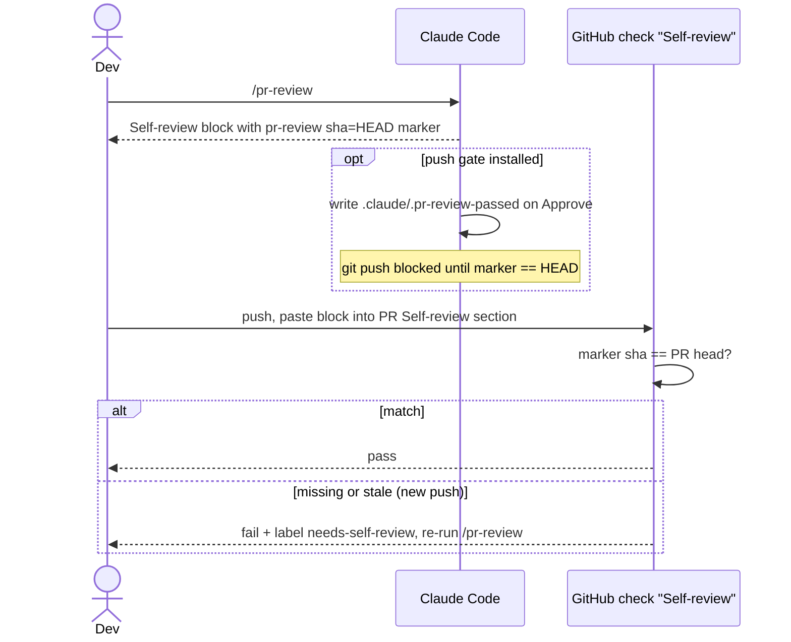

# hkirito

A spec-driven harness for Claude Code. One entry point, `/kirito-mode <task>`, classifies the task and runs the matching flow of skills. Spec: [`docs/specs/kirito-mode.md`](docs/specs/kirito-mode.md). Plan: [`docs/plans/kirito-mode.md`](docs/plans/kirito-mode.md).

## Flows



`[how]` runs only when the area is unfamiliar. `[blast-radius]` runs only when the diff touches a public interface, schema, data format, or widely imported export. `[architect]` runs when tickets cross a module seam, and `interrogate` joins it only when the design is contested. `review-loop` reports findings by class on two axes, Standards and Spec, and never dispatches a reviewer while tests, lint, or typecheck fail. `[+ improve-codebase-architecture]` is an optional survey for refactor candidates. Specs go to `docs/specs/<feature>.md`, plans to `docs/plans/<feature>/NN-<slug>.md`. Review runs only on the `pr` route.

### The `pr` route and `review-loop`

- **Clean context.** When the session already did other work, the route writes a `## Handoff` into the branch's review log (under the git directory, so it survives `/clear` and never shows in `git status`), then asks you to `/clear`, switch to Sonnet 5.5, and run `/kirito-mode pr <log path>`.
- **3 rounds, gate included.** Every round follows the `pr-review` checklist. A round that reviews the committed `HEAD` and finds no `must-fix` is the gate (and writes the marker when a `pr-review` skill exists); there is no separate full re-review. Round 3 without a pass stops for you. Commit before the round you expect to pass.
- **Deterministic checks first.** Tests, lint, and typecheck must be green before every reviewer dispatch; red checks are fixed without a round. The reviewer gets their output and a diff stat, and re-runs a check only when a finding needs more evidence.
- **Findings by class.** One finding per kind of defect, listing every location, so one fix pass clears it.
- **`REVIEW.md`.** Before the gate round, the main session proposes each `must-fix` class as a `REVIEW.md` entry (repo root) or a lint rule; you approve each one. Implementers and reviewers read `REVIEW.md` up front.
- **Models.** Opus 5.5 for specs, plans, and the `reviewer` (pinned, never overridden); Sonnet 5.5 for the main session during implementation and the `pr` route. The session asks you to switch with `/model`; it never switches for you.

### Skills you type yourself

These never load unless typed (`disable-model-invocation`): `/wayfinder` (plan work too big for one session as a map of decision tickets), `/statechart`, `/create-formal-verification-skill`, `/maintain-formal-verification-skill` (draw a model as a chart; useful for bugs that depend on event order; `/statechart` downloads TLC and Java with mise, about 305 MB, on its first run), `/sharpen` (deepen a task prompt), `/correct` (stop repeated agent mistakes structurally), `/wait-what` (re-pitch the last answer in plain terms), `/to-questionnaire`, `/wizard` (a script that walks a human through manual steps), plus `/learn`, `/retro`, `/handoff`, `/unslop`.

`/kirito-mode --delegate <task>` hands each feature ticket to a fresh `implementer` subagent while the main session runs Sonnet 5.5 (it asks you to switch before the first ticket, and back to Opus 5.5 before any later spec or plan). `to-tickets` tags each ticket `Model: haiku` (mechanical) or `Model: sonnet`; a Haiku ticket that fails its checks twice or draws a `must-fix` is re-dispatched once on Sonnet. The implementer is done only when tests, lint, and typecheck pass. In review, fixes of at most 2 files with no interface change are made inline, except a `must-fix` on an unescalated `haiku` ticket, which escalates to Sonnet in the batch; larger ones go to one implementer for the whole batch.

### Token usage

`node skills/review-loop/scripts/usage.mjs [session...]` (Node only, no install) reports one session per argument (a session `.jsonl` or directory; default: the latest session of the current project): main-session spend in total and from the first reviewer dispatch, every subagent (type, model, spend), sums per agent type and model, and cache rewrites after idle gaps longer than the cache TTL. Spend is in input-equivalent units from the published cache multipliers, not dollars.

## Install

```bash
git clone git@github.com:minhhuy1201/hkirito.git ~/hkirito
cd ~/hkirito

mkdir -p ~/.claude/skills ~/.claude/agents
for d in skills/*/; do
  name=$(basename "$d")
  if [ -e ~/.claude/skills/$name ] && [ ! -L ~/.claude/skills/$name ]; then
    echo "skip $name: a real directory exists in ~/.claude/skills (move it aside first)"
    continue
  fi
  ln -sfn "$PWD/skills/$name" ~/.claude/skills/$name
done
ln -sfn "$PWD/agents/reviewer.md" ~/.claude/agents/reviewer.md
ln -sfn "$PWD/agents/implementer.md" ~/.claude/agents/implementer.md
```

Start a new session and run `/kirito-mode <what you want done>`.

- Skills are not namespaced (`/kirito-mode`, `/tidy`, `/tdd`). Move aside any same-name skill in `~/.claude/skills/`, or the loop skips it.
- Disable the superpowers plugin (`enabledPlugins` in `~/.claude/settings.json`): its session hook competes with the router. Its two useful rules (verify before claiming done, verify each review finding) live in `kirito-mode`.
- To adapt: `skills/kirito-mode/SKILL.md` is the router, `routes/*.md` hold one flow each. `review-loop` and `agents/reviewer.md` assume the author's `CLAUDE.md` rules (branch names, Vietnamese review summary). `grill-with-docs` needs `grilling` and `domain-modeling` enabled (check `skillOverrides`).

## Commit gate (optional)

`tidy` strips needless comments and AI-sounding prose from the staged diff. The flow already runs it; a gate makes it hard to skip.



Pick one:

| Gate | Where it works | Setup |
|---|---|---|
| Claude hook | Machines where Claude hooks are allowed | Merge `hooks/settings-snippet.json` into `hooks.PreToolUse` in `~/.claude/settings.json`; replace `/ABSOLUTE/PATH/TO/hkirito`. Needs `python3`, `sha256sum`. |
| Git hook | Where Claude hooks are blocked | `cp ~/hkirito/githooks/pre-commit .git/hooks/pre-commit` (Husky: call it from `.husky/pre-commit`). Checks only when `CLAUDECODE=1`; human commits pass. |

## PR template and self-review (per project)

```bash
cd /path/to/your-project
mkdir -p .github/workflows
cp ~/hkirito/templates/github/pull_request_template.md .github/
cp ~/hkirito/templates/github/workflows/pr-self-review.yml .github/workflows/
```

Then make **Self-review** a required check in branch protection for the default branch.



- Push gate (optional): merge `hooks/settings-snippet-push-gate.json` into `hooks.PreToolUse` (same path replacement), and add `.claude/.pr-review-passed` to `.gitignore`. It only sees pushes from Claude Code; it is not a security boundary.
- Bot PRs (Dependabot) skip the check.
- Default branch is assumed `main`; change `origin/main` in `skills/pr-review/SKILL.md` step 1 if not. Edit the template wording and `<type>(<scope>)` rule to fit your team.

## Layout

```
skills/            kirito-mode, tidy, and the vendored and ported skills
agents/            reviewer.md, implementer.md
hooks/             commit and push gates + settings snippets (optional)
mods/              Claude Code mods; `pixel-blast` holds risky Bash commands behind a pixel report
templates/         PR template and Self-review workflow to copy into a project
githooks/          pre-commit (optional)
docs/              this repo's own spec and plan
THIRD_PARTY.md     upstream sources and licenses
```

Vendored skills carry a provenance comment naming the upstream repo and commit. See [THIRD_PARTY.md](THIRD_PARTY.md).
