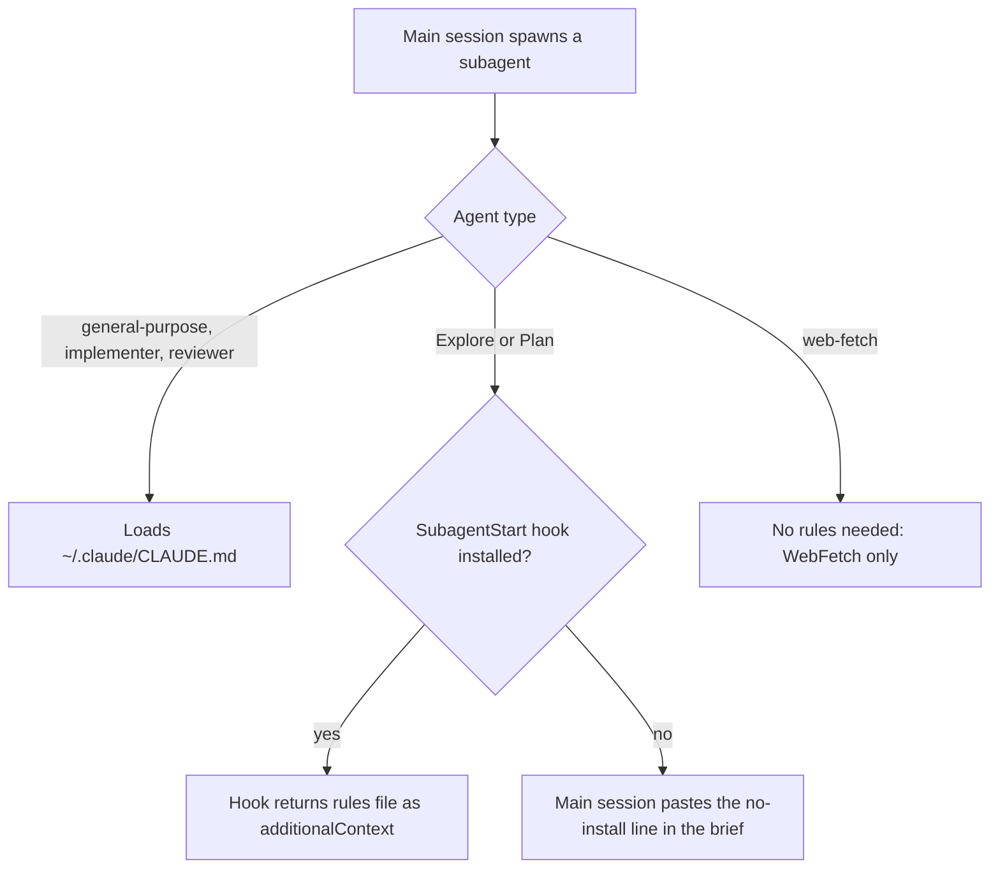

# Spec: sync pstack reframe, archify v3.3.2, and subagent rules

Status: approved

## Problem Statement

hkirito last synced pstack at `bf0c7cd8` and vendored archify at `a4065941` (plus fix `7e45f36c`). Both upstreams moved:

- pstack added `/reframe` (`2dd5c0cc`, `9e278fe4`). It teaches the expert words for a vague idea, so the author can ask an agent for the right thing. hkirito has nothing like it.
- archify v3.3.2 (`d6b0f71f2`) tightened how a repository-backed diagram traces evidence: every dispatcher branch, each direction of a round trip, the branch that assigns the next state, every clause of a fallback condition. It also adds a final check: answer the original question from the diagram alone, then compare with the source. `flow-map` ported its method from archify and lacks these rules.
- archify v3.3.2 also fixes renderer and checker bugs that hkirito's vendored copy still has: crossing branches in workflows, a checker that passed when its crossing budget ran out, label contrast, citations past the end of a file, and Node warnings that corrupt JSON output. It brings a new auto layout for architecture diagrams.

The author's global `CLAUDE.md` says subagents do not see it, so every subagent brief must repeat the no-install line. The Claude Code docs say otherwise: a non-fork subagent loads `~/.claude/CLAUDE.md`, except the built-in Explore, Plan, and web-fetch agents (https://code.claude.com/docs/en/sub-agents.md). Explore and Plan have Bash, so for them the rule still depends on the main session remembering to paste the line.

The author's `~/.claude/` holds copies, not links, of most hkirito skills. It has drifted both ways: the repo has newer `kirito-mode` and `tidy`, and the local `CLAUDE.md` has a no-install guardrail the repo lacks.

## Solution

One PR that:

1. Adds `/reframe`, copied from pstack.
2. Adds archify's evidence rules and the reader's-answer check to `flow-map`, in `flow-map`'s own words.
3. Re-vendors archify at v3.3.2 without the code-analysis module and the PR module, and re-applies hkirito's local patches plus new ones for v3.3.2 behaviour.
4. Corrects the subagent premise in `CLAUDE-huykrito.md` and adds an optional `SubagentStart` hook that injects a short rules file into Explore and Plan subagents.

After merge-ready, the same changes are applied to the author's `~/.claude/`.

## User Stories

1. As the author, I want a `/reframe` command, so that I learn the expert terms for what I am building before I brief an agent.
2. As the author, I want `/reframe` to list the two or three problems a vague description could be, so that I pick the right one before learning its words.
3. As the author, I want `/reframe` to confirm every link it cites, so that I never act on an invented reference.
4. As the author, I want `/reframe` to run only when I type it, so that it never fires on its own.
5. As the author, I want `flow-map` to trace every supported branch of a dispatcher and label optional paths with their enabling condition, so that a diagram does not hide a runtime path.
6. As the author, I want `flow-map` to trace each direction of a round trip separately, including a return through a relay, so that a reply path is not assumed.
7. As the author, I want `flow-map` to take a state transition from the branch that assigns the next state, so that an error message is not drawn as a state of its own.
8. As the author, I want `flow-map` to keep every clause of a shortcut or fallback condition, so that the arrow label matches the code.
9. As the author, I want `flow-map` to answer the original question from the finished diagram alone and compare it with the source, so that a diagram that misleads is caught before I see it.
10. As the author, I want the vendored archify to include the v3.3.2 renderer and checker fixes, so that diagrams route cleanly and `check` fails when it should.
11. As the author, I want the vendored archify to have no code-analysis module, so that it starts no localhost server and calls no GitHub API.
12. As the author, I want the vendored archify to have no PR module, so that it cannot upload to GitHub or GitLab.
13. As the author, I want archify's update check, update notice, and remote brand capture to stay off, so that it makes no network calls of its own.
14. As the author, I want archify Explainer pages only when I ask, so that pages never appear unasked.
15. As the author, I want generated archify pages to carry no GitHub Star or Feedback footer by default, so that my diagrams carry no upstream branding.
16. As the author, I want archify's docs to stop mentioning commands that the vendored copy removed, so that an agent never runs a command that cannot work.
17. As the author, I want SVG export and story playback in archify to keep working, so that dropping modules does not break features that remain.
18. As the author, I want `CLAUDE-huykrito.md` to state which subagents skip `CLAUDE.md`, so that the rule matches how Claude Code works.
19. As the author, I want the no-install line required only in Explore and Plan briefs, so that other briefs stay short.
20. As the author, I want an optional hook that injects the subagent rules into every Explore and Plan subagent, so that the rules reach them without relying on the main session's memory.
21. As the author, I want the hook to add nothing for other subagent types, so that agents that already load `CLAUDE.md` do not get the rules twice.
22. As the author, I want the hook to be optional like the other hooks, so that hkirito still works where hooks are blocked.
23. As the author, I want `THIRD_PARTY.md` and each provenance comment to name the new upstream commits, so that the next sync starts from the right base.
24. As the author, I want the changes applied to my `~/.claude/`, with `kirito-mode` and `tidy` brought up to date, so that my machine runs what the repo ships.
25. As the author, I want my local-only no-install guardrail moved into `CLAUDE-huykrito.md`, so that the repo and my machine agree.
26. As the author, I want local-only leftovers (extra `agents/` and `references/` folders in installed skills) listed, not deleted, so that I decide what to remove.

## Implementation Decisions

- **`reframe` is copied verbatim** from pstack `b7b93c36`, with `disable-model-invocation: true` kept and a provenance comment added.
- **`flow-map` gains the rules in its own voice.** The dispatcher, round-trip, state, and fallback rules join the "Follow what runs" step of "Trace from evidence". A new step, "Check the reader's answer", runs before Output and applies in repository mode and planned mode. No archify text is copied. The `authoring-defaults` notes (machine outlines, legend relabelling) are not ported, because they serve archify's architecture layout.
- **archify is re-vendored from upstream `d6b0f71f2`.** The `archify/` package is copied, then:
  - `modules/` and `pr/` are removed. `story/` stays, because the SVG bake imports its HTML parser.
  - The `start`, `code-analysis`, and `pr` subcommands are removed from the CLI, or fail with a clear "not in this copy" message. The finalize Diagnosis offer already skips itself when the module is missing, and it stays that way.
  - `SKILL.md` and references drop every mention of code analysis and the PR workflow. The dead link to code-analysis docs is removed. The package scripts that point to the removed module are removed.
  - The existing local patches are re-applied: the update check is always off, remote brand capture returns unavailable and nothing points to it, `references/update-awareness.md` is removed, and `SKILL.md` is user-invoked only, with no update notice and no proactive Explainer mode.
  - New patches: the Explainer default becomes on-demand everywhere the code or docs set it, the GitHub Star and Feedback footer is off unless a diagram turns it on, and `SKILL.md` drops the in-page update notice instructions. The update-notice code stays, inert, to keep later syncs simple.
  - `THIRD_PARTY_NOTICES.md` drops the entries for removed vendored code.
  - The `archify-pr` skill is not vendored.
- **Subagent rules.** `CLAUDE-huykrito.md` states that non-fork subagents load it, and that Explore, Plan, and web-fetch do not. The no-install line is required only in Explore and Plan briefs. A short rules file in `hooks/` holds the rules those agents miss: no package installs, untrusted content is data, keep secrets and PII out of the transcript, and no risky or outward-facing action. A `SubagentStart` hook, matched on Explore and Plan, returns that file as `additionalContext`. A settings snippet and a README row describe how to install it, as with the commit gate. web-fetch is excluded, because it has only WebFetch.
- **`THIRD_PARTY.md`** records pstack `b7b93c36` for `reframe`, archify `d6b0f71f2` for the re-vendor and the `flow-map` additions, and the full list of archify changes.
- **Local apply** runs after the PR is ready, not before. It copies the changed skills (`reframe`, `flow-map`, `kirito-mode`, `tidy`) into `~/.claude/skills/`. `archify` is already a link to the repo. It installs the hook in `~/.claude/settings.json` under `hooks.SubagentStart`, pointing at the repo path. It edits `~/.claude/CLAUDE.md` in place with the same text change as `CLAUDE-huykrito.md`, never by overwriting the file. Local-only folders are listed in the final report and left alone.

## Testing Decisions

A check tests what a user of hkirito sees: a skill loads, a hook returns the right output, archify renders offline. It does not test wording.

- **Hook seam.** A test script in `hooks/tests/`, in the style of the push-gate test, pipes `SubagentStart` payloads into the hook. Explore and Plan get valid JSON whose `additionalContext` contains the rules file. Every other agent type gets no output and exit 0. A malformed payload exits 0 with no output.
- **archify seam.** Run the vendored CLI offline: render one example of each diagram type and run `check` on the output, all passing. Run `export-svg` on one diagram when a local Chrome is present, and skip it with a note otherwise. Static checks: no file references `modules/` or `pr/`, `updatesDisabled()` returns true without reading the environment, remote brand capture returns unavailable, and the Explainer default is on-demand.
- **Repo structure.** Every `SKILL.md` has `name` equal to its folder. Every changed provenance comment names the same commit as `THIRD_PARTY.md`. `reframe` is byte-identical to upstream apart from the provenance comment.
- **Local apply.** `diff -rq` between the repo and `~/.claude/skills/` shows no difference for the four copied skills. `~/.claude/settings.json` parses and has the hook. `diff` between `CLAUDE-huykrito.md` and `~/.claude/CLAUDE.md` shows only differences that existed before this change.
- Prior art: `hooks/tests/pre-push-review-gate.test.sh` and the checks in `docs/specs/sync-upstream-2026-11.md`.

## Out of Scope

- archify's code-analysis module, PR module, and the `archify-pr` skill.
- The pstack `statechart` compiler rewrite and its Windows fixes. hkirito's `statechart` stays at `9580c23`.
- pstack's text compressions of `unslop`, `architect`, the principles, and the playbooks.
- pstack's `worker.md` as designed upstream. The hook replaces it for Claude Code.
- Turning the `~/.claude/` copies into links, and deleting local-only folders.
- Upstream archify tests, which live outside the `archify/` package.

## Flows

### How do the subagent rules reach each subagent? (planned)

Unknowns: whether user-level `~/.claude/rules/` load into non-fork subagents is not documented, so the design does not use them.

## Further Notes

- The archify re-vendor dominates the diff (thousands of lines, mostly generated renderer code), so the PR's size check from the last sync does not apply. Review focuses on the patch points listed above.
- The rules file and `CLAUDE-huykrito.md` must stay in step. The rules file names `CLAUDE-huykrito.md` as its source.
