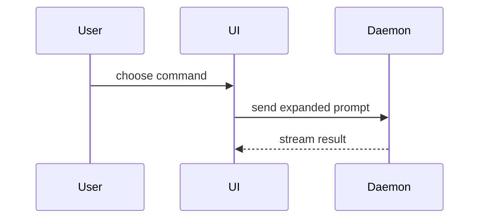

A **sketch** is a tiny text visual in the PR body that shows the reviewer the shape of the change before they open the diff. It goes into the repo's PR template (the Summary/Description section), beside the one or two sentences it illustrates.

## When to sketch

Sketch only when the change has a shape a sentence can't carry: a new call path, moved files, a changed control flow, a new component in a tree, several actors talking, data passing through new stages, a schema change. A one-file fix, rename, dependency bump, config tweak, or copy change gets prose only - the sketch would just restate the diff.

## Reuse the spec's flow

When the PR ships a spec with a `## Flows` section, the sketch is a trimmed copy of the one flow that best shows what changed, so the PR and the spec show the same picture. Keep its `new` class, cut it to the budget below, and use it even though it is Mermaid. Draw a fresh sketch only when the flow no longer matches the code, and fix the spec too.

## Budget

- One sketch per PR; two only when the PR has two independent parts.
- Up to ~15 lines each. Show only the calls, files, components, and states the reviewer needs to answer "what changed and where does it sit?" - name the rest `...` or leave them out.
- Plain text over Mermaid. Reach for Mermaid only when three or more actors exchange messages.

## Pick the form

Prefer a `diff` sketch when the surrounding shape already exists - `+`/`-` lines show exactly what moved. Use a plain sketch when most of it is new.

| Change | Form |
|---|---|
| Logic / algorithm | pseudocode |
| Runtime flow | call tree |
| Data flow | pipeline: `source → transform → sink`, with the data's shape at each stage |
| Schema / migration | `diff` on the table definitions; Mermaid `erDiagram` when relations change across three or more tables |
| UI structure | component tree, with file path on the parts that matter |
| Refactor / file moves | shallow file tree with `# role` comments |
| Several actors exchanging messages | Mermaid `sequenceDiagram` |

Call-tree change:

```diff
 submitForm
   createSession
     persistPrompt
+    expandSkillMention
     launchAgent
   navigateToSession
+    subscribeToEvents
```

File-layout change:

```diff
 src/
 ├── commands/
+│   └── show-me.ts       # expands the slash command
-└── transport.ts
+└── transport/
+    ├── client.ts
+    └── stream.ts
```

Control-flow change:

```diff
 on(save)
+  if content is unchanged
+    return cached result
   write new content
+  invalidate cache
```

Data-flow change:

```diff
 orders.csv          {id, amount, currency}
   → parseRows       Order[]
+  → convertToUsd    Order[] (amount in USD)
   → aggregateDaily  {date, total}
   → BigQuery daily_totals
```

Schema change:

```diff
 table orders
   id          uuid pk
   amount      numeric
+  currency    char(3) not null default 'USD'
-  customer    text
+  customer_id uuid fk → customers.id
```

Multi-actor flow:


